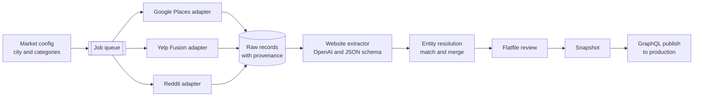

## The problem

Every new city Planned launched in needed a vetted list of event vendors: venues, caterers, AV, and decor. The business team built it by hand. They searched Google Maps, cross-checked reviews on Yelp, Google, and Reddit, copied details into spreadsheets, and then uploaded the spreadsheets to the main database. One market took about 16 hours. Upload errors went straight into production data.

## My role

I owned the problem end to end. I interviewed the business team, scoped the tool, designed the data schema and the pipeline, and wrote the requirements. To make them concrete, I built a crude proof of concept with an early AI coding agent and handed it to an engineer with the requirements. The engineer built the production tool.

## Constraints

- **Four sources, four shapes.** Google, Yelp, Reddit, and vendor websites each return different fields, IDs, and formats, and they often disagree about the same business.
- **Rate limits and terms of service.** Each API has its own quota and its own rules on what can be stored. Vendor websites have no API at all.
- **Production data at risk.** The tool wrote to the same database customers use. A bad import could not be allowed to stick.
- **Non-technical users.** The business team works in spreadsheets, not admin consoles.
- **No engineering capacity.** The core team was committed to the customer product. A working proof of concept let an engineer start building without a long back-and-forth on requirements.

## Key decisions

**1. One adapter per source, one canonical schema.** Each source sits behind an adapter that makes the REST calls, pages through the results, and maps each response into one canonical record. Downstream code never sees a source-specific shape, so adding a source means writing one adapter. I derived the schema backward from the production vendor schema, so every field had a destination and review could validate against the same rules production enforces.

```ts
type VendorCandidate = {
  source: 'google' | 'yelp' | 'reddit' | 'website';
  sourceId: string;     // Google place ID, Yelp business ID, page URL
  fetchedAt: string;    // ISO 8601
  name: string;
  address?: { line1: string; city: string; region: string; postalCode: string };
  geo?: { lat: number; lng: number };
  phone?: string;       // normalized to E.164
  website?: string;     // normalized to the bare domain
  categories: string[]; // mapped to Planned's vendor categories
  rating?: { value: number; count: number };
  raw: unknown;         // original response, kept for audit and re-mapping
};
```

**2. A job queue with per-source rate limits and backoff.** A market run fans out into independent jobs, one per category, source, and results page. Each source gets its own rate limiter, set below its published quota. The worker handles each class of response differently:

| Response | Meaning | Handling |
| --- | --- | --- |
| 200 with results | Normal | Store raw records; queue the next page |
| 200, no results | Nothing in this category | Mark the job complete |
| 429 Too Many Requests | Over quota | Wait for `Retry-After` if sent, else exponential backoff with jitter |
| 5xx | Source error | Retry with backoff, up to 5 attempts, then move to a dead-letter queue |
| Other 4xx | Bad request or expired key | No retry; log and alert |

Jobs are idempotent: records are keyed by source and source ID, so a retried job overwrites its own output instead of creating duplicates. Because jobs are independent, every source runs in parallel at the speed its limit allows. A market of about 3,000 candidates finished in under 15 minutes.

**3. Stay inside each source's terms instead of fighting blocks.** The way to avoid IP bans is to send no traffic a source would want to block. The pipeline used the official APIs (Google Places, Yelp Fusion, Reddit) for everything they cover, at rates below their quotas. Vendor websites, which have no API, were fetched politely: robots.txt honoured, one request at a time per domain with a delay, an identifiable user agent, and each page fetched once per run and cached. Google's terms limit how long Places content can be cached, so the pipeline stores place IDs as permanent keys and refreshes the details it needs at onboarding time.

**4. Entity resolution with field-level rules, and people for real conflicts.** The same venue shows up in several sources with slightly different names, phone numbers, and addresses.

- **Match.** Two records are the same vendor if they are within 250 m of each other and share a normalized phone number or website domain, or if they are within 100 m and their names are highly similar.
- **Merge.** Each field takes its value from the most trusted source for that field: contact details and hours from Google, categories and price level from Yelp, and services and capacity from the vendor's own website.
- **Conflict.** Real conflicts, such as two different phone numbers from trusted sources, are not resolved automatically. They are flagged for a person to decide, and every field shows which source it came from.

**5. LLM extraction with a strict output schema.** Vendor websites have no common format, so rule-based scrapers broke on most of them. The extractor strips each page to its main text, sends it to the OpenAI API with a JSON schema for the fields we need, and validates the response against that schema. Output that fails validation is flagged, never published. Results are cached by URL and content hash, so a re-run doesn't pay for the same page twice.

**6. Review in Flatfile, publish behind a snapshot.** Building an editable, validated data grid would have taken weeks. Flatfile gave the business team a spreadsheet-style review screen with schema validation in days, at the cost of a paid third-party dependency. Before any import, the tool snapshots the affected vendor collections, so one click restores the previous state. That made it safe for the business team to publish directly, without an engineering ticket for each market.

## What I built

My proof of concept set out the pipeline:



1. **Discover.** Source adapters search by city and vendor category and collect candidate businesses.
2. **Extract.** The tool fetches each vendor's website, and the OpenAI API turns the page into structured fields.
3. **Resolve.** Records for the same vendor are matched and merged, with conflicts flagged.
4. **Review.** Records open in Flatfile, where the team fixes, removes, or approves them against the production schema.
5. **Publish.** Approved records go to the main database through the GraphQL API, after an automatic snapshot.

## After launch

The business team ran the tool for each new market. Early runs merged separate locations of chain businesses, because they shared a head-office phone number. That is why every match now also requires the two records to be close together.

## Outcome

- Onboarding time per market fell from 16 hours to 6, saving about 10 hours of manual work for every new market.
- Markets, categories, and sources are configuration, not code, so the same pipeline generates vendor data for any market, and for other datasets.

## What I'd do differently

I would log every reviewer correction to the AI-extracted fields from day one. That data shows where extraction fails, and it would have let me improve the prompts with evidence instead of spot checks.
