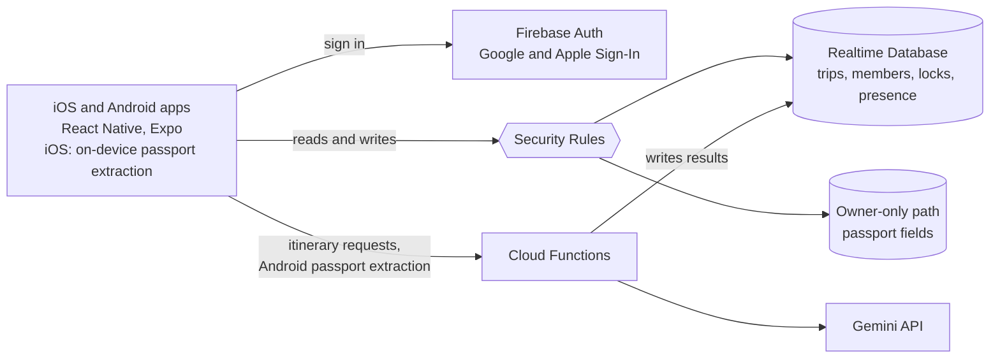

## The problem

Group trips are planned across chat threads, shared spreadsheets, and screenshots of bookings. Nobody has a single, current version of the plan. The founder wanted one app where a group builds an itinerary together, gets AI-generated suggestions, and keeps travel documents in one place.

## My role

I worked with the CTO on the solution design: the data model, the concurrency approach, and the security model. I implemented it: the backend, the mobile app, the AI integration, and the builds. The founder owned the vision, priorities, and user feedback.

## Architecture



The apps talk to the database directly, so Security Rules act as the server. Anything that needs a secret or slow work goes through Cloud Functions, which write results back to the database so every trip member sees them.

## Constraints

- **Passport data is the highest-risk data in the app.** A leak of passport details would end the product. The goal was to keep as little of it as possible, in as few places as possible.
- **The database does not merge concurrent edits.** Realtime Database keeps the last write to a path. Transactions make a single update atomic, but they don't merge two people's edits to the same itinerary item: the second save still replaces the first.
- **Offline writes replay later.** The Firebase SDK caches data and queues writes while a phone is offline, which suits travellers. But a queued edit can land hours later on top of newer changes, and a lock can't be taken without a connection.
- **Security Rules are the only server-side check.** With no API server in between, every permission and every data shape had to be enforced in rules. Rules can read data at known paths, but they can't run queries.

## Key decisions

**1. Firebase over a custom backend.** I compared Firebase with a Node and Postgres API. Firebase gave us auth, real-time sync, storage, and rules without running a server, so a working product was up in days. The cost is vendor lock-in and weak querying, which I accepted for an MVP whose first job is to prove demand.

**2. Shape the data model around Security Rules.** Because rules can't query, every permission check had to be a direct lookup. Each trip stores a members map keyed by user ID, so one read confirms membership:

```js
".read": "root.child('trips').child($tripId).child('members').child(auth.uid).exists()"
```

Read access in Realtime Database cascades: granting read on a trip grants it on everything under the trip. So private data, such as passport fields, can't live under the trip at all. It lives under a separate path that only its owner can read. Rules also validate the type and shape of every write. Validation in the app gives a fast, friendly error; the rules are the enforcement, so a modified client can't write bad data.

**3. Field-level locks, taken atomically, on server time.** When two people edited the same trip, the default behaviour let the second save silently overwrite the first. I compared three options:

| Option                                                                                                                                              | Benefit                                     | Cost                                              |
| --------------------------------------------------------------------------------------------------------------------------------------------------- | ------------------------------------------- | ------------------------------------------------- |
| Last-write-wins (default)                                                                                                                           | No extra work                               | Silent data loss; users stop trusting the plan    |
| Conflict-free replicated data types (CRDTs), which merge concurrent edits automatically, or operational transforms, the approach behind Google Docs | Everyone edits at once with no lost changes | Weeks of work and a heavier data model for an MVP |
| Field-level locks (chosen)                                                                                                                          | Prevents overwrites with little code        | One person edits a field at a time                |

The details are where locks usually fail:

- **Taking a lock is a transaction.** It succeeds only if the field is unlocked or the existing lock has expired, so two people tapping the same field at once can't both win.
- **Locks use the server's clock.** Lock timestamps come from `ServerValue.TIMESTAMP`, not the phone's clock, so a phone set to the wrong time can't hold a lock forever or take one early.
- **Locks clean themselves up.** `onDisconnect()` releases a lock when the app crashes or loses signal, and a 60-second lease clears any lock that slips through.
- **No shared edits offline.** The app watches Firebase's connection state and disables editing shared fields while offline, because an offline edit can't hold a lock. Each person's own data still works offline.

**4. Passport data: extracted on the device on iOS, never stored on the phone.** On iOS, Apple's on-device models extract the passport fields, so the image never leaves the phone and no third-party API sees it. On Android, extraction goes through Gemini by way of a Cloud Function, so the API key never ships in the app. On both platforms nothing from the passport is saved on the device. The image is discarded after extraction, and only the fields the trip needs (name, nationality, expiry date) are written to the owner-only path. The user confirms the extracted fields before they're saved, because a model can misread a photo.

**5. AI itinerary generation runs on the server and writes into the trip.** Gemini calls take seconds, so the app doesn't wait on them. A Cloud Function generates suggestions and writes them into the trip, where they sync to every member like any other edit. Keeping the call on the server also lets the function cap request size and retries, which keeps cost predictable.

## What I built

- Trip workspaces with invites, member roles, and a shared itinerary that syncs live on every device.
- The field-locking layer described above, with presence indicators.
- AI itinerary suggestions from the trip's destination, dates, and group preferences, using Gemini.
- Passport capture with on-device extraction on iOS, Gemini extraction on Android, and owner-only storage.
- Google and Apple Sign-In, and iOS and Android builds from one Expo codebase.

<!-- locked-media -->

## After launch

I handed the MVP over with build instructions and a list of known limitations. I fixed the bugs found in founder testing, mainly sign-in configuration differences between iOS and Android.

## Outcome

- Working MVP on both platforms in 10 weeks.
- No overwrite conflicts in group testing after field locking shipped.
- The founder used the build for investor and early-user demos.

## What I'd do differently

I would write the Security Rules and their tests first, before any feature code. In this architecture the rules are the backend, and rules added afterwards are easy to get wrong. The passport data made that the highest-risk part of the app.
